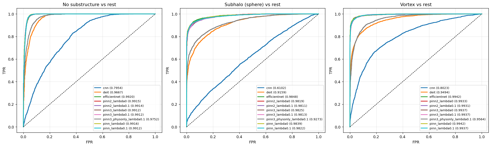
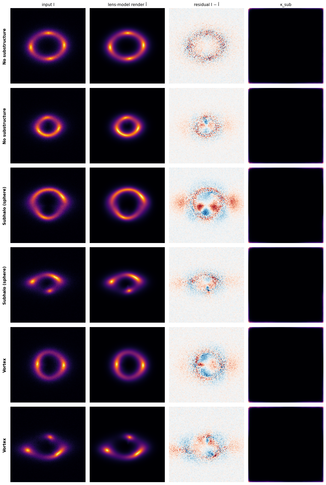
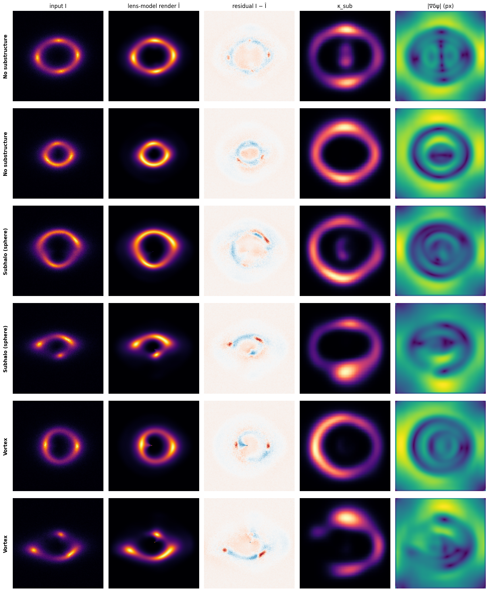
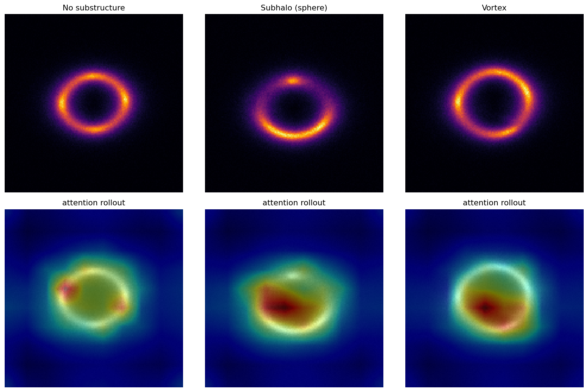

# DeepLense: Gravitational Lensing Substructure Detection

Classifying dark-matter substructure in simulated strong gravitational lensing images
(3 classes: **no substructure**, **spherical subhalos**, **vortex**) with four models that
share one data pipeline, one training loop and one held-out test set:

| # | Model | Idea |
|---|---|---|
| 1 | **Custom residual CNN** | designed from scratch for 1-channel 150×150 maps |
| 2 | **EfficientNet-B0** | ImageNet transfer learning, 1-channel stem, two-stage fine-tuning |
| 3 | **PINN** (3 iterations) | EfficientNet encoder + a differentiable lens model: the image is rendered with the **lens equation** (SIE + shear lens, Sérsic source, PSF) and the **2D Poisson equation ∇²ψ = 2κ** is embedded in the loss for the substructure perturbation |
| 4 | **DeiT-Tiny** | Vision Transformer with a 1-channel patch embedding at native resolution (10×10 tokens) + attention rollout |

## Results

Held-out test set: 7,500 images (2,500 per class), never used for model selection. Single seed.
Trained on an Apple M3 (MPS, batch 32), except PINN v2/v3 (Colab T4, AMP, batch 64).

| Model | Params | Test accuracy | Test macro AUC | AUC no sub | AUC subhalo | AUC vortex |
|---|---|---|---|---|---|---|
| **EfficientNet-B0** | 4.0 M | **93.9 %** | **0.9903** | 0.9920 | 0.9848 | 0.9942 |
| PINN v1, λ = 0 (physics off) | 4.6 M | 93.9 % | 0.9899 | 0.9916 | 0.9839 | 0.9942 |
| PINN v1, λ = 0.1 (Poisson loss on) | 4.6 M | 93.7 % | 0.9890 | 0.9912 | 0.9822 | 0.9937 |
| PINN v2 lens model, λ = 0 | 5.0 M | 93.4 % | 0.9889 | 0.9915 | 0.9819 | 0.9933 |
| PINN v2 lens model, λ = 0.1 | 5.0 M | 93.3 % | 0.9886 | 0.9914 | 0.9811 | 0.9931 |
| PINN v3, λ = 0 | 5.6 M | 93.6 % | 0.9891 | 0.9912 | 0.9825 | 0.9937 |
| PINN v3, λ = 0.1 | 5.6 M | 93.3 % | 0.9887 | 0.9912 | 0.9813 | 0.9937 |
| **PINN v3, physics-only classifier** | 5.6 M (0.6 M classifier) | 83.7 % | **0.9529** | 0.9752 | 0.9273 | 0.9564 |
| DeiT-Tiny | 5.4 M | 82.1 % | 0.9440 | 0.9667 | 0.9159 | 0.9494 |
| Custom CNN (from scratch) | 4.9 M | 56.1 % | 0.7360 | 0.7954 | 0.6102 | 0.8023 |



### Takeaways

- **Transfer learning dominates.** At similar size, pretrained EfficientNet-B0 beats the from-scratch
  CNN by 0.25 AUC. The CNN stayed at chance for ~18 epochs before finding the signal and was still
  improving at epoch 30: under-trained, not incapable.
- **Subhalos are the hardest class** for every model. The most common error is subhalo → no
  substructure: small point-like subhalos barely perturb the Einstein ring.
- **DeiT-Tiny needed ViT-specific fine-tuning.** The first run collapsed to a constant prediction
  (val accuracy exactly 1/3, loss = ln 3, AUC 0.548) as soon as the backbone unfroze at LR 2e-4.
  Using DeiT's LR scaling (≈3e-5 backbone at batch 32) fixed it: AUC 0.944, still rising.
  The collapsed run is kept in `results/deit_v1_collapsed/`.
- **The lens-equation forward model is what makes the PINN useful.** PINN v3 fits a simulator-matched
  lens to every image (R² ≈ 0.99). A small 0.6 M-parameter CNN that sees *only* the physics residual
  (observed − rendered), with no classification gradient into the physics, reaches **0.953 AUC**. A 4.9 M
  from-scratch CNN on raw images reaches 0.736. Combined with backbone features, every PINN variant ties
  EfficientNet (~0.989).
- **The Poisson / κ_sub pathway did not become a substructure detector.** In v3 the substructure mass
  map collapsed to ~0, and all of the physics-only signal is in the residual (see below).

### PINN: what the physics branch actually learned

All three versions embed the 2D Poisson equation ∇²ψ = 2κ in the loss. Full analysis in
`notebooks/03_pinn_poisson.ipynb`.

**v1** (`pinn.py`) predicted the potential ψ̂ and convergence κ̂ freely. With the Poisson loss on, it
found a trivial solution: ψ̂ ≈ 0 with a constant κ̂ satisfies the equation, giving a mean deflection of
0.15 px, i.e. no lensing at all. v1 also applied the lens equation in the wrong direction (it re-lensed
the observed image instead of reconstructing a source).

**v2** (`pinn_lens.py`) makes lensing necessary by forward-modelling each image. A lens head predicts an
SIS + external-shear macro-lens and an elliptical Gaussian source. The image is rendered with the lens
equation, Î(θ) = S(θ − α_macro − ∇δψ), and must match the input. The Poisson loss ties the learned
perturbation δψ to a non-negative substructure convergence κ_sub.

| | v1, λ = 0.1 | **v2, λ = 0.1** | v2, λ = 0 |
|---|---|---|---|
| Test macro AUC | 0.9890 | **0.9886** | 0.9889 |
| Macro-lens deflection | 0.15 px | **27.5 px** | 31.9 px |
| Perturbation ∇δψ | n/a | **7.3 px, mass-backed** | 31 px, massless |
| Image reconstruction R² | n/a | **0.965** | 0.974 |
| Poisson residual | ~2e-3 (trivial) | **0.056** | 34 |

- **v2 learns real lensing:** Einstein radii of ~27 px, with the rendered rings matching the observations.
- **The Poisson loss has a measurable physical effect.** Without it, the network adds a 31-px deflection
  backed by *no mass*, which is unphysical but fits pixels slightly better. With it, the perturbation is 7 px and
  generated by a non-negative mass map.
- **κ_sub is not yet a substructure detector.** It is the same for every class (map correlation 0.69
  within and across classes) and traces the ring: it compensates for SIS + shear being unable to model
  lens ellipticity. Removing the physics features from the classifier costs only ~0.001 AUC.

**v3** (`LensingPINNv3`) is built from the DeepLenseSim generator, which uses lenstronomy with an SIE +
external-shear main halo, an elliptical Sérsic (n = 1) source, a Gaussian PSF, point-mass CDM subhalos, and
a line of point masses for vortices. Changes from v2:

- The macro-lens is SIE + shear, the source is an elliptical Sérsic, and the render includes the PSF and a
  background level. All of these follow lenstronomy's conventions and are verified against it to ~1e-6.
- κ_sub comes from a U-Net over multi-scale encoder features (75×75 instead of a 5×5 bottleneck).
- Sparsity and minimum-deflection (|∇δψ|²) priors. Local tests showed the perturbation otherwise
  exploits two degeneracies: mass placed in empty sky (invisible to the data) and massless harmonic modes
  (which satisfy the Poisson term with κ_sub = 0).
- **Physics-only mode:** the classifier sees only [residual, κ_sub, lens parameters], detached from the
  classification loss, so the physics maps are shaped only by reconstruction + Poisson + priors.

| | v2, λ = 0.1 | v3, λ = 0.1 | v3, λ = 0 | **v3 physics-only** |
|---|---|---|---|---|
| Test macro AUC | 0.9886 | 0.9887 | 0.9891 | **0.9529** |
| Image reconstruction R² | 0.965 | 0.988 | 0.989 | **0.991** |
| Macro-lens deflection | 27.5 px | 27.0 px | 27.0 px | 27.0 px |
| Perturbation ∇δψ | 7.3 px | 0.28 px | 0.32 px | 0.34 px |
| Poisson residual (val) | 0.054 | 0.008 | 0.084 | 0.010 |
| Mean κ_sub | 0.10 | ~3e-7 | ~2e-7 | ~5e-7 |

Which physics output carries the class signal? Physics-only classifier, with each input zeroed at test time
(1,200 test images):

| inputs | AUC |
|---|---|
| residual + κ_sub + lens params | 0.952 |
| without the residual | 0.485 (chance) |
| without κ_sub | 0.952 |
| without lens params | 0.952 |
| lens params only | 0.486 (chance) |

**Findings**

- **The forward model works.** With simulator-matched lens and source models, a single network pass
  reproduces each image with R² ≈ 0.99 (v2: 0.965). The remaining residual is where substructure lives.
- **Physics residuals are a strong representation.** Classifying from the residual alone gives 0.953 AUC
  with a 0.6 M-parameter classifier trained from scratch, against 0.736 for the 4.9 M from-scratch CNN on raw
  images. Caveat: the lens-fitting backbone is ImageNet-initialised (trained only by the physics losses),
  and the raw-image CNN was still improving when it stopped, so the gap is indicative, not a controlled comparison.
- **The lens parameters carry no class information.** In the generator the main halo is the same for
  every class, so the substructure lives entirely in the residual.
- **κ_sub collapsed.** The priors that removed v2's degeneracies also drove κ_sub to ~0. Subhalo
  deflections here are ≲ 1 px, below what the amortised fit resolves. The Poisson term still controls
  the *type* of perturbation: without it (λ = 0) the Poisson residual is 10× larger (0.084 vs 0.008),
  i.e. the perturbation is less mass-consistent. But it no longer affects classification.
- **No accuracy gain over EfficientNet.** When backbone features are available, the classifier ignores
  the physics features (removing them costs ~0.001 AUC), exactly as in v1 and v2.

**What would come next:** per-image refinement of the lens fit at inference (a few optimisation steps on
the 15 parameters, which reached R² ≈ 0.99+ in direct fits) to push residuals to the noise level, and a
parametric substructure model (point masses / a line mass, as in the generator) instead of a free κ_sub map.



<details><summary>PINN v2 physics maps</summary>



</details>

### DeiT-Tiny attention rollout



## Repository layout

```
deeplense/                 importable package
  data.py                  dataset, split policy, D4 augmentation, leakage check
  physics.py               finite-difference ∇, ∇², Poisson residual, lens-equation ray tracing
  models/
    cnn.py                 LensingCNN
    efficientnet.py        EfficientNet-B0 with 1-channel stem
    pinn.py                PINN v1 + PINNLoss (CE + λ·‖∇²ψ̂ − 2κ̂‖²); superseded, see findings
    pinn_lens.py           PINN v2 (SIS+shear, Gaussian source) and v3 (SIE+shear, Sérsic source, PSF,
                           U-Net substructure decoder, physics-only mode), rendered with the lens
                           equation; Poisson loss on the substructure perturbation (δψ ↔ κ_sub)
    deit.py                DeiT-Tiny, 1-channel, 160-px padding, attention rollout
  train.py                 shared training loop (warm-up+cosine, discriminative LR, freezing)
  metrics.py               ROC/AUC, confusion matrix, plots
scripts/train.py           CLI: train any model with its recipe
notebooks/
  00_data_exploration      class examples, mean-difference maps, leakage check
  01_custom_cnn
  02_efficientnet_transfer
  03_pinn_poisson          physics derivation; v1 and v2 maps, λ ablations and diagnostics
  04_deit_tiny             attention rollout
  05_model_comparison
  colab_train_pinn2/3      train PINN v2 / v3 on a Colab T4 (AMP, per-epoch checkpoints on Drive, resume)
results/<run>/             metrics.json, history.json, figures (checkpoints are git-ignored)
legacy/                    original notebooks, kept for reference
```

## Data

DeepLense common test I data: `.npy` arrays of shape (1, 150, 150), min-max normalised.
Place it at `data/lensing/{train,val}/{no,sphere,vort}/*.npy` (10k / 2.5k per class).

**Split policy.** `train/` is split 90/10 (stratified) into training and validation; the
best epoch is chosen on validation macro AUC. `val/` is used **only** as the final test set.
A hash-based check found no duplicate images within or across splits.

## Usage

```bash
pip install torch torchvision timm numpy scikit-learn matplotlib

# smoke test (laptop, ~1 min)
python scripts/train.py --model cnn --train-per-class 300 --test-per-class 100 --epochs 2

# full runs, one at a time
python scripts/train.py --model efficientnet
python scripts/train.py --model pinn --lambda-poisson 0.1

# or everything sequentially, with logs in results/logs/ (skips finished runs)
PYTHON=python scripts/run_all.sh cnn efficientnet deit pinn:0.1 pinn:0
```

Approximate full-run times on an 8 GB Apple M3 at batch 32: CNN 1.3 h, EfficientNet 2.5 h,
DeiT 1.5 h, PINN 3 h each.

Each notebook has a `SMOKE` flag (subset, 2 epochs) and loads an existing full run from
`results/` when one exists, so you can train from the CLI and analyse in the notebook.

## Method notes

- **Augmentation**: random element of the dihedral group D4 (90° rotations + flips). These are exact
  symmetries of lensing images and need no interpolation, unlike arbitrary-angle rotation.
- **1-channel adaptation of pretrained nets**: pretrained RGB kernels are *summed*, so the
  1-channel layer responds to a gray image *x* exactly as the original did to (*x*, *x*, *x*).
- **PINN loss**: `L = CE + λ · mean((∇²ψ̂ − 2κ̂)²)`, with the 5-point Laplacian scaled by the
  grid spacing. With κ̂ ≥ 0 (softplus), the constraint also forces ψ̂ to be generated by
  non-negative mass. λ = 0 is the same architecture with physics disabled (ablation baseline).
